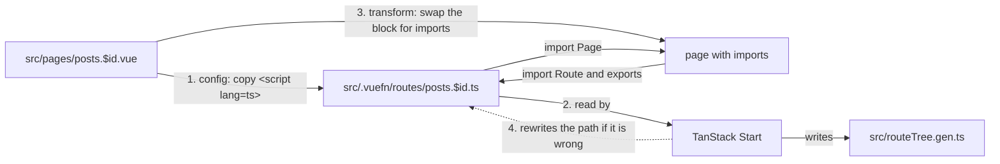

# Contributing

Thank you for helping with vuefn. This page tells you how to set up the repo, make a change, and open a pull request.

## Requirements

- [Node.js](https://nodejs.org/) `^22.23.4`, `^24.22.1` or `>=26.12.1`
- [Bun](https://bun.com/) 1.4.4, the version in `packageManager`

## Setup

```bash
git clone https://github.com/pyyupsk/vuefn.git
cd vuefn
bun install
bun run build
```

## Commands

```bash
bun run dev           # build vuefn, then run the playground on port 3000
bun run build         # build packages/vuefn to dist/, with publint and attw
bun run test          # run all tests once
bun run test:coverage # run the tests with a coverage report in coverage/
bun run test:pack     # pack vuefn, install it in a temp app and load it with Node
bun run test:e2e      # build the playground, run it on workerd and test it in Chromium
bun run lint          # oxlint, type-aware
bun run format        # oxfmt
bun run typecheck     # build, then type-check the package and the playground with vue-tsc
```

After you change `packages/vuefn/src`, stop `bun run dev` and start it again. Vite does not reload its own config.

Run one test file:

```bash
bun run test packages/vuefn/src/utils/sfc.test.ts
```

To try a change in a real app, run the playground. It is a TanStack Vue Start app on Cloudflare Workers:

```bash
bun run --filter playground build
bun run --filter playground preview
```

## Project structure

```text
packages/vuefn   vuefn         the Vite plugin and defineRoute
apps/playground  playground    pages that use every feature, run on workerd
scripts/         pack-test.ts  installs the packed tarball like a user would
```

Inside `packages/vuefn/src`:

```text
index.ts         defineRoute and defineRootRoute, typed with TanStack's route types
vite.ts          the vuefn() plugin
lib/generate.ts  reads src/pages and writes src/.vuefn/routes
utils/sfc.ts     finds the route block and builds the route and page code
```

## How the plugin works



1. In `config`, vuefn reads every `src/pages/*.vue` and writes `src/.vuefn/routes/<name>.ts` with the `<script lang="ts">` block and `createFileRoute(path)`.
2. TanStack Start reads `src/.vuefn/routes` and writes `src/routeTree.gen.ts`.
3. In `transform`, vuefn replaces the block in the page with an import of `Route` and of every name the block exports.
4. If TanStack writes a different path into a route file, the path in `defineRoute` does not match the file name. vuefn then stops the build.
5. If a page is added, changed or deleted during `vite dev`, the file watcher writes its route again.

The block must be a real `.ts` file before TanStack Start reads it. A `createServerFn()` that stays in a `.vue` file loses its handler on the server.

## Conventions

- Lint and format: [oxlint](https://oxc.rs/docs/guide/usage/linter) and [oxfmt](https://oxc.rs/docs/guide/usage/formatter), with the same rules as GeoThai/npm-packages.
- Folders: pure functions go in `utils/`, code that reads or writes files goes in `lib/`.
- Tests: put `*.test.ts` next to the file it tests.
- JSDoc with an `@example` on every export of `index.ts` and `vite.ts`. Other files have comments only where the code cannot say why.
- Commit messages: [Conventional Commits](https://www.conventionalcommits.org/), one line of 60 characters or less, about what a user can do now:
  - `feat: add route params from file names`
  - `fix: keep the route file after a template edit`
  - `docs: explain how to use vuefn`
- After you change a file in `.github/workflows/`, run `gh act update --pin` to pin each action to a commit SHA.

## Pull requests

1. Fork the repo and create a branch from `main`.
2. Make your change.
3. Add or update tests. Make sure that `bun run test` passes.
4. Run `bun run format`, `bun run lint` and `bun run typecheck`.
5. If you changed the package files or the build, run `bun run test:pack`. If you changed how pages render, run `bun run test:e2e`. The first time, install Chromium with `bunx playwright install chromium` in `apps/playground`.
6. Commit with a Conventional Commits message.
7. Open a pull request against `main`.

CI runs format, lint, the tests, typecheck and the e2e tests on Ubuntu 24.04, and sends coverage to Codecov. It also loads the packed tarball on Node 22.23.4 and 24.22.1. All checks must pass before a merge.
